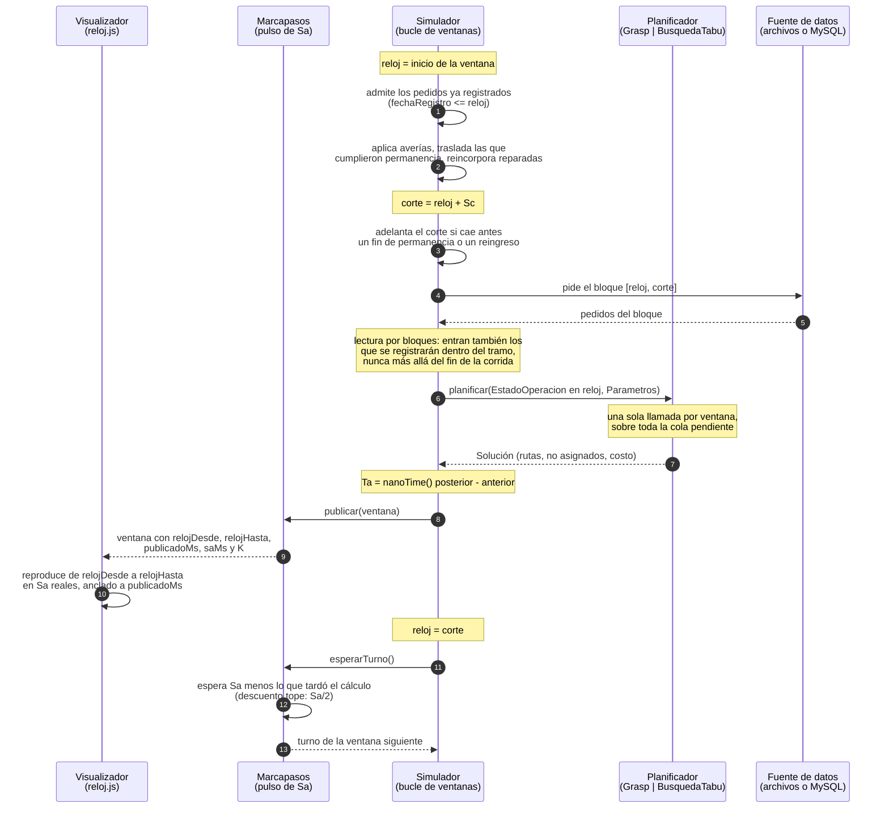

# Consumo de datos en bloques Sc por cada bloque Sa del planificador

Equipo 2B · 1INF54 · Semana 12 · Ítem A22

Este diagrama describe **el ritmo tal como está implementado**, no el propuesto. Las fuentes son
`backend/src/main/java/com/paqrap/api/RitmoEscenario.java` (qué Sa y qué Sc recibe cada
escenario), `codigo/paqrap/src/main/java/com/paqrap/simulacion/Ritmo.java` (la relación entre
los dos), `Simulador.java` (el bucle que consume el bloque) y
`backend/src/main/java/com/paqrap/api/Marcapasos.java` (el pulso con que sale cada ventana).

## Los tres tiempos

| Símbolo | Qué es | Dónde vive | Se fija o se mide |
| --- | --- | --- | --- |
| **Ta** | Lo que demora una planificación | `Simulador`: `System.nanoTime()` alrededor de `planificador.planificar(...)` | **Se mide.** Crece con la cola de pedidos |
| **Sa** | Tiempo **real** entre el inicio de una planificación y el de la siguiente | `Ritmo.saltoDelAlgoritmo`, respetado por `Marcapasos` | Se fija por escenario |
| **Sc** | Tiempo **de la operación** que avanza en cada salto | `Ritmo.saltoDelConsumo()` = `Sa × K` | Se deriva de Sa y K |
| **K** | Proporcionalidad entre el reloj de la operación y el de la pared | `Ritmo.proporcionalidad` | Se fija por escenario |

La aceleración no sale de hacer más rápido el algoritmo: sale de **consumir más datos por vez**.
Subir K no cambia ninguna decisión del planificador, solo agranda el trozo de operación que se
resuelve en cada corrida.

## Qué Sa y qué Sc usa cada escenario

Valores por omisión, calculados por `RitmoEscenario.para(...)`:

| Escenario | Sa | K | Sc | Ventanas | Duración real |
| --- | --- | --- | --- | --- | --- |
| Operación diaria (`OPERACION_DIARIA`) | 60 s | **1** (fijo) | **60 s** | 1 440 por día | 24 h por día (tiempo real) |
| Cinco días (`PERIODO_5_DIAS`) | 20 s | 180 | **60 min** | 120 | 40 min |
| Colapso (`COLAPSO`) | 10 s | 720 | **120 min** | 360 (30 días) | hasta 60 min |

Los grados de libertad que acepta la API:

- **Operación diaria**: ninguno sobre K. Solo `segundosPorVentana` cambia Sa (y con él Sc);
  `velocidad` distinta de 1 o `minutosPorVentana` responden `400 RITMO_INVALIDO`.
- **Cinco días**: se pide la `duracionObjetivoMin` (30 a 60, por omisión 40) y de ahí sale K con
  Sa fijo en 20 s. A 30 min, Sc = 80 min y 90 ventanas; a 60 min, Sc = 40 min y 180 ventanas.
  Fuera de ese rango la API responde `400 RITMO_INVALIDO`.
- **Las dos simulaciones**: `segundosPorVentana` (1 a 600) y `minutosPorVentana` (1 a 1440)
  fijan Sa y Sc directamente. `RitmoEscenario.saltoDelConsumo()` redondea Sc a segundos enteros, porque los
  cortes del reloj de la operación no llevan fracciones.

## La operación diaria no es una simulación

Empieza en la fecha y hora actuales del servidor —no se elige— y K vale 1, así que Sc = Sa y el
reloj de la operación es el de la pared: nunca salta ni se acelera.

```
eje real        18:50      18:51      18:52      18:53      18:54
(Sa)              |----------|----------|----------|----------|
                  [Ta]       [Ta]       [Ta]       [Ta]
                   | plan     | plan     | plan     | plan
                   v          v          v          v
eje de la       18:50      18:51      18:52      18:53      18:54
operación (Sc)    |----------|----------|----------|----------|
```

En cada Sa se planifica **una vez** con los pedidos registrados hasta ese instante; lo que
tarda es Ta, que se mide. Ese plan se ejecuta durante el Sc que empieza ahí mismo. Lo que se
registra dentro de un salto —un pedido, una avería— entra en la planificación del siguiente.

Dos consecuencias en el código:

- `EjecucionesService` arma el simulador con latido e intervalo mínimo iguales a Sc, de modo
  que hay exactamente un corte por salto. En las simulaciones los cortes siguen los eventos.
- Con saltos de un minuto una bicicleta (5 min por cuadra) no llegaría nunca a la esquina
  siguiente si cada corte la devolviera a la anterior. Por eso el día a día usa
  `Simulador.completandoLaCuadraEnCurso()`: la unidad termina la cuadra que empezó y recién
  ahí puede ser redirigida.

Medido con los datos de septiembre (15/09, 24 h): 1 435 planificaciones, Ta medio 187 ms y
máximo 725 ms frente a un Sa de 60 000 ms, sin saltos rebasados ni pedidos vencidos.

## Los dos ejes en las simulaciones

Un salto de Sa en el eje real equivale a un salto de Sc en el eje de la operación. Con una
ventana de 20 min simulados cada 20 s (K = 60):

```
eje real          0s        20s        40s        60s        80s
(pared)           |----------|----------|----------|----------|
                   ventana 1  ventana 2  ventana 3  ventana 4
                      Sa         Sa         Sa         Sa

eje de la       08:00      08:20      08:40      09:00      09:20
operación         |----------|----------|----------|----------|
                      Sc         Sc         Sc         Sc

dentro de una ventana:  [ Ta ][ ---- espera hasta completar Sa ---- ]
                         ^ se mide           ^ Marcapasos la descuenta
```

El planificador se lanza **una vez por ventana** y resuelve de una sola vez todo el tramo de
`Sc` que viene. Entre dos lanzamientos nadie replanifica: eso es exactamente lo que mide Sc.

## Una ventana, paso a paso



## Por qué Sa tiene que ser mayor que Ta

Si una planificación tarda más que su salto, la siguiente arrancaría sobre una que no terminó.
`Ritmo.ocupacion(ms)` informa qué fracción del salto ocupó cada cálculo y `Marcapasos` cuenta las
veces que se rebasó (`rebasadas()`), dato que el resumen de la corrida publica. Como Ta crece con
la cola, un Sa que alcanza con demanda normal puede quedarse corto cerca del colapso, que es
justo cuando más importa.

La serie completa de Ta medidos se consulta en
`GET /api/ejecuciones/{id}/rendimiento`: cantidad de llamadas, Ta medio, mínimo, máximo y
percentil 95, con descarga de evidencia en JSON desde el bloque «Rendimiento del planificador»
del riel.

## Por qué Sc no puede ser cualquiera

Sc es cuánto tiempo de operación pasa sin que nadie replanifique. Con los plazos del caso —entre
4 y 10 horas— un Sc de 8 o 24 horas dejaría que un pedido llegue y venza sin haber sido
planificado nunca. Por eso Sc se mantiene en una o dos horas incluso en los escenarios
acelerados: el servidor calcula una ventana por delante de lo que se ve, así que una avería
registrada desde la pantalla entra al cálculo al final de la ventana visible. Con ventanas de
varias horas ese desfase se notaría.

## Lo que este ritmo no decide

Sa, Sc y K son **presentación**: marcan el pulso con que las ventanas salen a la pantalla y el
tamaño del bloque que se consume. Ninguna decisión del planificador depende de ellos. El reloj
simulado (`relojDesde`/`relojHasta`) y el tiempo real de cómputo (`inicioRealMs`, `finRealMs`)
viajan por separado en cada vista, de modo que el visualizador los distingue en todo momento.

## Pendiente

Las mediciones de Ta y de memoria **en la VM del curso** siguen sin registrarse; el protocolo y
la tabla vacía están en `docs/RENDIMIENTO_VM.md`. Los valores de esta página son los que fija el
código, no mediciones de la VM.
