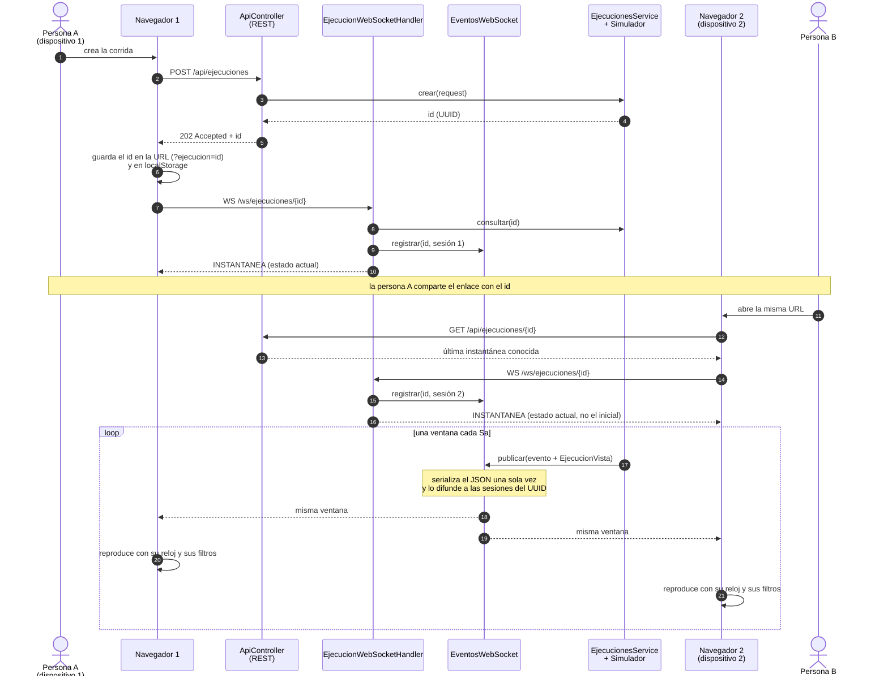
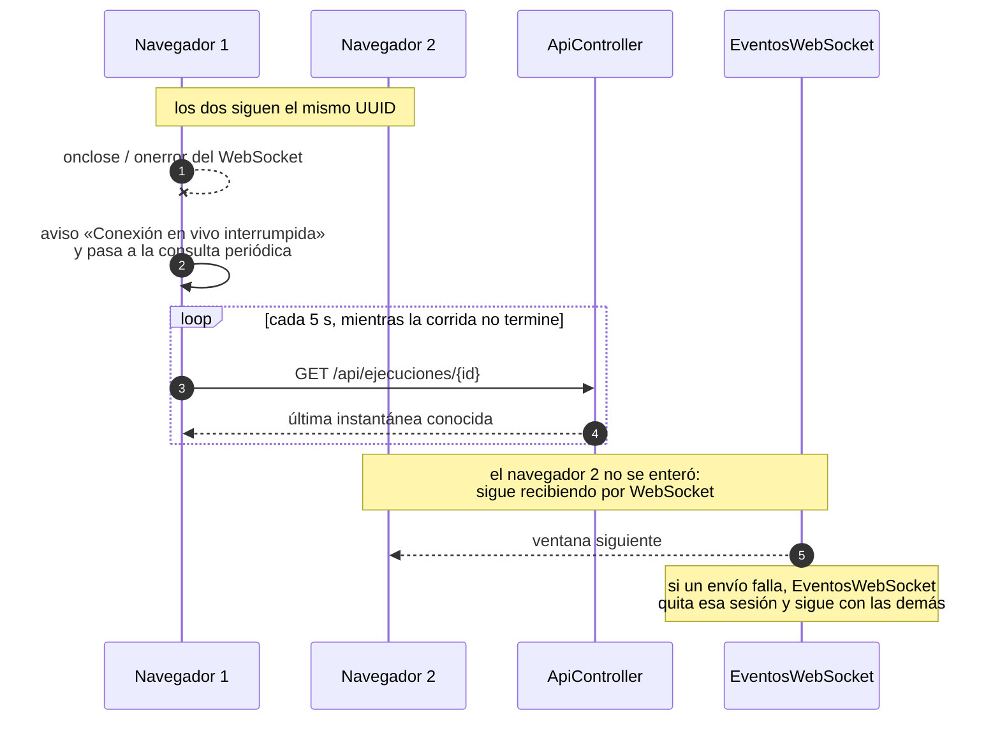

# Interacción de varios navegadores durante la simulación del periodo

Equipo 2B · 1INF54 · Semana 12 · Ítem A23

Este diagrama describe **lo implementado**, no lo propuesto. Las fuentes son
`backend/src/main/java/com/paqrap/api/EjecucionWebSocketHandler.java` y `EventosWebSocket.java`
(el canal en vivo y su difusión), `ApiController.java` (qué puede pedir cada navegador) y
`frontend/src/App.jsx` junto con `frontend/src/reloj.js` (qué hace cada navegador con lo que
recibe).

## La regla de fondo

Una corrida es **un UUID**. Todos los navegadores que abren ese UUID ven la misma corrida, pero
cada uno mantiene su propia vista: su reloj, sus filtros, su selección y su posición en el
historial. El servidor no guarda estado de interfaz de nadie.

## Cómo se suma un navegador

Quien llega tarde no recibe la corrida desde el principio: recibe la **instantánea del momento**
y, a partir de ahí, las ventanas nuevas. El historial anterior lo recupera por REST
(`/fotogramas` y `/planes`), que es paginado y conserva los planes previos.

## Qué es independiente y qué es compartido

| Independiente por navegador | Compartido por la corrida |
| --- | --- |
| Vista activa (mapa, pedidos, averías) | Estado de la corrida (`EN_CURSO`, `PAUSADA`, `TERMINADA`, …) |
| Reloj mostrado, anclado a `publicadoMs` con su propio desfase | El reloj simulado que publica el servidor |
| En vivo o reproduciendo un instante histórico (`indiceFotograma`) | El historial de fotogramas y de planes |
| Zoom y encuadre del mapa | Las rutas, el inventario y las averías aplicadas |
| Filtros por tipo y por semáforo | — |
| Unidad, almacén o ruta seleccionada | — |
| Umbrales del semáforo (`localStorage`, por dispositivo) | — |

Las acciones de **consulta** no se ven entre navegadores. Las acciones que cambian la corrida sí:
`POST /averias`, `/cancelar`, `/pausar` y `/reanudar`. Un navegador que registra una avería no
toca la pantalla de los demás de forma directa: cambia la corrida, y todos lo ven en la ventana
siguiente que publica el servidor. Es la excepción prevista por el criterio.

El canal en vivo es **de una sola dirección**: `handleTextMessage` cierra la sesión con
`NOT_ACCEPTABLE` ante cualquier mensaje entrante. Ningún navegador puede mandar nada por el
socket, ni al servidor ni a otro navegador. Todo lo que modifica la corrida pasa por REST y por
sus validaciones.

## Qué pasa cuando a un navegador se le corta el canal

La consulta de respaldo cada 5 s existe en todo momento, no solo tras una caída
(`App.jsx`, `setInterval(consultar, 5000)`), de modo que un corte del socket degrada la fluidez
pero no la corrección. Sobre esa base, cada navegador refresca por REST el inventario y las
averías cada segundo, los eventos cada 1,5 s y los fotogramas y planes cada 900 ms.

Un cliente lento **no frena la simulación**: `EventosWebSocket` difunde copias ya serializadas y
descarta la sesión cuyo envío falla, sin tocar el hilo del simulador.

## Dos relojes de pared distintos, un solo instante simulado

Cada ventana viaja con `publicadoMs` (cuándo la publicó el servidor), `saMs` y `K`. Cada
navegador calcula su propio `desfaseConServidor(ritmo, recibidoMs)` y deriva el instante
mostrado de cuánto tiempo real pasó desde la publicación, no de sumar un paso por cuadro. Por eso
dos dispositivos con relojes desajustados, o con tasas de refresco distintas, muestran el mismo
instante simulado. El avance por cuadro se limita a `TOPE_CUADRO_MS = 250`, así que una pestaña
que estuvo dormida alcanza al objetivo en pocos cuadros en lugar de saltar.

## Si el servidor se reinicia

Las corridas viven en memoria. Si el servidor se reinicia, el UUID deja de existir y **todos** los
navegadores reciben el mismo `404`: cada uno limpia su id guardado y muestra «El servidor se
reinició o la corrida ya no existe». Ninguno queda mostrando datos de una corrida que ya no está.

## Pendiente

La prueba está hecha entre **dos pestañas del mismo equipo**, con filtros, historial y zoom
independientes y una de ellas en instante histórico. Falta ejecutarla desde **dos dispositivos
físicos distintos** contra la VM del curso: es el caso `CPA-ESC-06` de
`docs/CPA_API_ESCENARIOS.md` y el pendiente que declaran los ítems C05 y G06.
